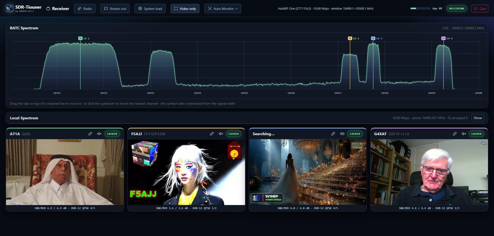
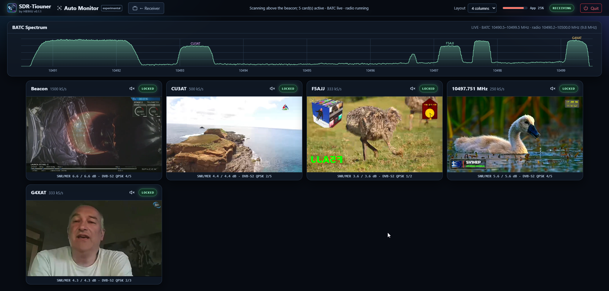

# SDR-Tiouner

A receiver for the QO-100 wideband transponder that decodes several DVB-S/S2 channels at the same time from one SDR radio and shows the pictures in a web browser. I wrote it as a software alternative to the MiniTiouner, mainly for my own use, and I'm sharing it in case it is useful to somebody else.



It is built on top of [OnAir](https://github.com/adswill/OnAir). The receiver itself (demodulation, decoding, the radio drivers) is the work of the OnAir authors, not mine. What I added is the multi-channel web interface, the Auto Monitor and the Windows packaging. See [Credits](#credits).

## What it does

One radio captures the whole transponder (10 Msps, 10490.5 to 10499.5 MHz). Each channel gets its own decoder, up to 8 by default. You open a page in your browser and see the spectrum and a card for every channel with its SNR, MER, level, mode, service name, and the video with audio. The BATC wideband spectrum is shown at the top and you can click on it to tune.

The **Auto Monitor** page (`/monitor`) works on its own: it starts the radio, shows the beacon first, then scans the band above it using the BATC spectrum and opens a new card for every station it finds. When a station goes away its card goes too.



Every running channel is also sent as the untouched transport stream over UDP, so you can open it in VLC or OBS or record it, like with the MiniTiouner. The Record button in the menu does that for you: it writes the stream of every running channel (except the beacon) to a `recordings` folder.

The pages can also be opened from another PC on the same network, see [LAN_VIEWING.md](LAN_VIEWING.md).

## Radios

| Radio | Notes |
|---|---|
| HackRF One | Native driver. This is the one I use every day. |
| SDRplay RSP | Through the SDRplay API, which you install from SDRplay. I have an RSP2. |
| Airspy R2 / Mini | Native driver, 10 Msps. |
| PlutoSDR | USB or network. The speed of the link decides how much of the band you get. |
| FISHBall-PlutoSky (Z7020-AD9361) | Appears in the list as a PlutoSDR (native driver). Over Ethernet it runs at the full 10 Msps without dropping samples, so you get the whole band. Over its USB connection it ran at only about 5 Msps. |
| LimeSDR Mini | Needs USB 3 for the whole band, and the Microsoft Visual C++ Redistributable (x64), which most PCs already have. |
| RTL-SDR | Only about 2.4 Msps: one channel, maybe a second one if it is very narrow (low symbol rate) and falls inside the same window. Not the 1.5 MS/s beacon. |

If a radio can't deliver 10 Msps you get a narrower window of the band. The page shows which part, and which channels fit in it.

## Getting started

You need Windows 10 or 11 (64-bit, a CPU with AVX2), a QO-100 receive chain with an LNB, and one of the radios above. The Auto Monitor also needs an internet connection, because it reads the BATC spectrum.

1. Download the latest zip from the [Releases](https://github.com/HB9IIU/SDR-Tiouner/releases) page of this repository. **Extract the whole zip** into a folder of your own (right-click, Extract All). Do not run the program from inside the zip.
2. Run `Start SDR-Tiouner.cmd`. Your browser opens at `http://127.0.0.1:47321`.
3. Choose your radio on the Receiver page and press **Start receiving**, or open **Auto Monitor**, which starts the radio by itself.
4. To use the pages from another PC, run `Enable LAN access.cmd` once as administrator.

Without a radio you can try `SDR-Tiouner.exe --demo`, which generates two test carriers.

More details are in [MULTI_RECEIVER.md](MULTI_RECEIVER.md) and [AUTO_MONITOR.md](AUTO_MONITOR.md).

## Things you should know

- This is an early version (0.1.x) of a hobby project. I developed and tested it on Windows, mostly with the HackRF. The other radios got less testing. Please tell me what works and what doesn't.
- The Auto Monitor only knows the band as BATC's receiver sees it. A weak station may not lock on your side, and only carriers whose plateau reaches 60% of the beacon's are tried.
- I have not tried it on Linux or macOS.
- **Updates.** A few seconds after the start, the program asks GitHub which release is the latest. If yours is older, the menu shows "Update x.y.z available", with a link to the release page. It downloads nothing and sends nothing about you. To switch it off, put `check_updates=0` in `multi-receiver.ini`. To update, extract the new zip into a new folder and copy your old `multi-receiver.ini` into it, so that you keep your radio, your calibration and your settings.

## If it doesn't work

These are the things I ran into myself:

- **Windows says a DLL is missing** (`libhackrf.dll`, `libwinpthread-1.dll`, `libgcc_s_seh-1.dll`, `libSoapySDR.dll` ...). The program was started without the files that belong to it, usually from inside the zip. Extract the whole zip first and start `Start SDR-Tiouner.cmd` from the extracted folder.
- **The radio is not listed.** Unplug it, wait a few seconds and plug it in again, preferably into a port directly on the PC and not through an unpowered hub. Close every other program that may hold the radio: SDRplay and Airspy can only be used by one program at a time. For an SDRplay the SDRplay API must be installed, and then restart SDR-Tiouner.
- **The radio is listed, but nothing locks and the page says the radio is not delivering samples.** A USB radio sometimes gets stuck, especially after a program was killed instead of closed. Close SDR-Tiouner with the **Close** button on the Receiver page, replug the radio and start again.
- **"No beacon received".** Nothing at all is locking, so look at the dish, the LNB and the cable. The LNB needs its power (about 18 V on many LNBs) from somewhere: SDR-Tiouner does not switch on a bias-T of the radio.
- **The beacon locks, then loses lock, then locks again.** Then the signal is just very close to what the decoder needs (SNR around 5 dB). More gain did not help on my setup; the dish and the LNB matter more.
- **The pages do not open from another PC.** Run `Enable LAN access.cmd` as administrator, once, on the receiver PC, and make sure the network is set to Private in Windows.

If that does not solve it, please open an issue here (not with the OnAir team) and tell me the version, the radio, what the page says, and the text in the console window.

## Building from source

On Windows with [MSYS2](https://www.msys2.org/), in the UCRT64 shell:

```bash
pacman -S --needed mingw-w64-ucrt-x86_64-toolchain mingw-w64-ucrt-x86_64-cmake mingw-w64-ucrt-x86_64-ninja \
  mingw-w64-ucrt-x86_64-pkgconf mingw-w64-ucrt-x86_64-hackrf mingw-w64-ucrt-x86_64-libusb \
  mingw-w64-ucrt-x86_64-ffmpeg mingw-w64-ucrt-x86_64-openssl
git clone https://github.com/HB9IIU/SDR-Tiouner.git
cd SDR-Tiouner
cmake -S . -B build-windows -G Ninja -DCMAKE_BUILD_TYPE=Release
cmake --build build-windows --target onair_multi -j8
```

That gives you `build-windows/onair_multi.exe`. To run it, `ffmpeg.exe`, `mediamtx.exe` and the radio libraries have to be next to it or on the `PATH`; [runtime/README.md](runtime/README.md) explains where they come from. The zip I publish is made with `bash tools/package/make_multi_windows.sh`, which needs the same files in `runtime/windows-base`.

To run the tests, build everything with `cmake --build build-windows -j8` and then `ctest --test-dir build-windows`. They decode in real time, so they take a few minutes.

## Credits

Nothing here would exist without **OnAir**. The receiver, the DVB-S/S2 decoding, the signal processing and the radio drivers come from [adswill](https://github.com/adswill) and the [OnAir contributors](https://github.com/adswill/OnAir/graphs/contributors), and all the credit for that part goes to them. I only built a multi-channel web interface and some packaging on top.

One of those contributors is the well-known **Évariste Courjaud (F5OEO)** of the DATV community. His work in OnAir that this program relies on includes the 8-bit LDPC decoder for DVB-S2, the AVX2 resampler and the PlutoSDR discovery. Thank you, Évariste.

Thanks also to BATC for the wideband spectrum feed, to the authors of the libraries used here (FFmpeg, MediaMTX, Bootstrap, miniaudio, libhackrf, libairspy, librtlsdr, libiio, LimeSuite, libbladeRF), and to SDRplay for their API. The licences of the components are listed in `THIRD-PARTY-NOTICES.txt` in the package.

I wrote this with a lot of help from Claude (Anthropic) as a coding assistant.

## Licence

GNU General Public License v3.0 or later, the same as OnAir, see [LICENSE](LICENSE). The complete source code is in this repository. The zip also carries [SOURCE-OFFER.txt](SOURCE-OFFER.txt), which says where to get the source, so that a copy of the zip passed on without this page still points to it.

It is free of charge and not for sale. The GPL would allow someone to sell copies, so this is just my wish and not an extra condition: if anybody asks you to pay for it, please don't, and let me know.

## Contact

Daniel, HB9IIU. If something does not work, or you have a question or a result to share, please contact me and not the OnAir team: SDR-Tiouner is my modification of their program, and a problem you see here is most likely mine, not theirs. Please open an issue in this repository, or find me on QRZ.com: [qrz.com/db/HB9IIU](https://www.qrz.com/db/HB9IIU). It helps if you say which radio you use, which version, and what the page showed.

Only if you can reproduce the problem with the original OnAir program, please report it to OnAir.
